<!-- Muhammad Sohail | Visual GitHub Profile -->
<!-- All referenced SVG images must exist in the repository's cards/ folder. -->
<a href="https://github.com/msohaiilkz">
  
</a>

  <a href="https://github.com/msohaiilkz?tab=repositories"></a>
  <a href="https://www.linkedin.com/in/muhammad-sohail-0227a7224"></a>
  

 
 <h2>About Me &amp; Expertise</h2><h2>Technology Stack</h2>
<h2>GitHub Activity</h2>
Contribution cards are refreshed by GitHub Actions using available GitHub activity data.
 
 <h2>Featured GitHub Repositories</h2>

  <a href="https://github.com/msohaiilkz/mentor_club_global"></a>
  <a href="https://github.com/msohaiilkz/mh-tech-solution"></a>

  <a href="https://github.com/msohaiilkz/Sentient-Ai"></a>
  <a href="https://github.com/msohaiilkz/Ridely"></a>

  <a href="https://github.com/msohaiilkz/Trees-System-Solution"></a>

 
 <h2>Featured Projects</h2>

  <a href="https://aegis-ui.netlify.app"></a>
  <a href="https://shaheeninsurance.netlify.app"></a>

  <a href="https://greycoast.netlify.app"></a>
  <a href="https://stafforalglobal.netlify.app"></a>

  <a href="https://pronexuss.netlify.app"></a>
  <a href="https://sageconz.netlify.app"></a>

  <a href="https://ezeedigitallab.netlify.app"></a>
  <a href="https://mufazimpexe.netlify.app"></a>

  <a href="https://edolutions.com/"></a>
  <a href="https://erudex01.netlify.app"></a>

<h2>Currently Exploring</h2>
<h2>Let's Connect</h2>

  
  
  

<!-- END: no tables, long text blocks, or duplicate avatar -->
